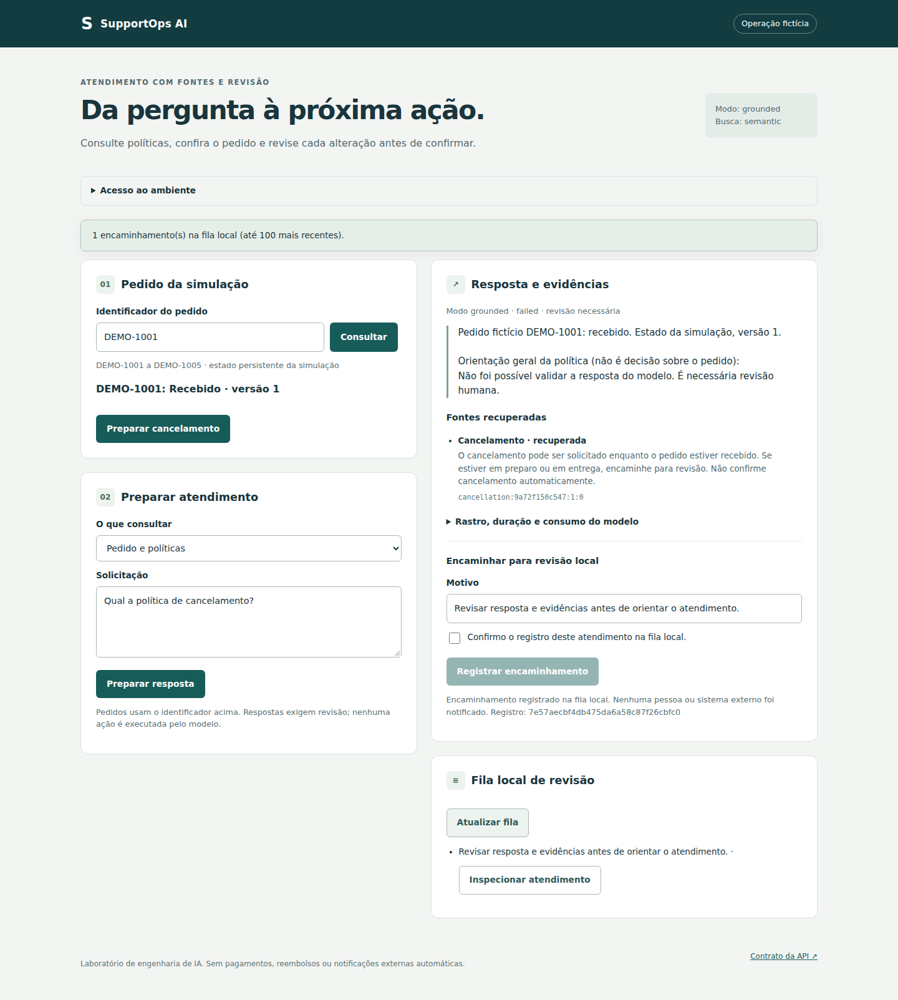

# SupportOps AI

Criei o SupportOps AI para estudar como integrar modelos de linguagem a uma aplicação de suporte com fontes verificáveis e operações controladas. Usei uma operação **fictícia** de delivery: a aplicação prepara respostas, consulta pedidos, registra encaminhamentos para revisão e permite cancelamentos sintéticos somente após confirmação explícita.

Desenvolvi o projeto com apoio de ferramentas de IA. Meu foco foi reunir código funcional, experimentos reproduzíveis e limites documentados, sem apresentar a demonstração como uma operação real.



[Vídeo da demonstração](docs/demo/supportops-demo.webm) · [Arquitetura](docs/architecture.md) · [Resultados do modelo](evaluation/RESULTS_V3.md) · [Limitações](docs/limitations.md) · [Artigo técnico](docs/technical-note.md)

## Executar

Python 3.12. Na raiz do repositório:

```bash
cd projects/supportops-ai
python3 -m venv .venv
.venv/bin/pip install -r requirements.txt
.venv/bin/uvicorn supportops.api:app --host 127.0.0.1 --port 8000
```

Abra **http://127.0.0.1:8000**. Mantive `demo + lexical` como padrão porque funciona sem modelos, contas ou credenciais. A tela identifica o modo e não apresenta trechos recuperados como geração de LLM. Contratos em `/docs`.

Para reproduzir uma demonstração sem reutilizar o estado anterior, aponte `SUPPORTOPS_ACTION_DB` para um arquivo novo. O banco padrão fica em `var/actions.sqlite3` e persiste entre reinícios.

## Roteiro de demonstração

1. Consulte `DEMO-1001` e envie “Qual a política de cancelamento?”.
2. Inspecione resposta, fontes, referências, duração, consumo e rastro.
3. Marque a confirmação do encaminhamento e registre-o na fila local; use “Atualizar fila” e “Inspecionar atendimento”.
4. Prepare o cancelamento, revise pedido/estado/validade e confirme explicitamente.
5. Consulte novamente ou peça somente o estado: o pedido aparece cancelado, inclusive após reiniciar a API.
6. Consulte `DEMO-1002`: o estado em preparo não permite cancelamento automático. `DEMO-9999` demonstra ausência de dados.

Nenhuma ação chama pagamentos ou serviços reais. Encaminhamento significa registro numa fila local; não significa notificação enviada a uma pessoa. Optei por controlar o fluxo e as ferramentas com estados e contratos explícitos. Não implementei um agente autônomo que escolhe e executa alterações.

## Inferência local real

Use Ollama com os modelos já calibrados:

```bash
ollama pull qwen3:1.7b
ollama pull qwen3-embedding:0.6b
# Inicie ollama serve se o serviço ainda não estiver rodando.
SUPPORTOPS_MODE=grounded SUPPORTOPS_RETRIEVAL=semantic OLLAMA_MODEL=qwen3:1.7b .venv/bin/uvicorn supportops.api:app --host 127.0.0.1 --port 8000
```

Implementei o modo `grounded` para verificar hashes, recuperar políticas, aplicar um limiar e pedir ao modelo uma referência curta. Python devolve a citação integral aprovada ou uma mensagem fixa de esclarecimento/recusa. Todas as respostas exigem revisão. Mantive o modo `ollama` de geração livre apenas para pesquisa, com as falhas documentadas; não é aceito na composição de pedido e política.

`SUPPORTOPS_RETRIEVAL` aceita `lexical`, `semantic` e `hybrid` (RRF). Grounded exige semantic. O limiar 0,47 e o digest do embedding estão em `data/grounding-v3.json`; trocar o modelo/corpus exige revisão e nova calibração. As variáveis estão em [.env.example](.env.example); Python lê variáveis exportadas, sem carregar esse arquivo automaticamente.

## Contratos principais

| Endpoint | Função |
| --- | --- |
| `POST /tickets` | Preparar resposta; salva fontes e rastro. |
| `GET /tickets/{trace_id}` | Inspecionar atendimento persistido. |
| `GET /orders/{id}` | Consultar o snapshot estático original. |
| `GET /simulation/orders/{id}` | Consultar o estado persistente da simulação. |
| `POST /simulation/cancellations/proposals` | Preparar proposta válida por cinco minutos. |
| `POST /simulation/cancellations/confirmations` | Confirmar alteração com chave de idempotência. |
| `POST /handoffs` / `GET /handoffs` | Registrar encaminhamento confirmado / consultar fila local. |
| `POST /integrations/tickets` | Preparar atendimento com recibo deduplicado por `event_id`. |
| `GET /health` | Verificar processo e configuração; não testa o modelo. |

```bash
curl -s http://127.0.0.1:8000/tickets -H 'Content-Type: application/json' -d '{"question":"Qual a política de cancelamento?","request_type":"order_policy","order_id":"DEMO-1001","order_source":"simulation"}'
```

`request_type`: `policy`, `order_status` ou `order_policy`. A interface usa `order_source=simulation`; preservei `snapshot` como padrão para clientes que omitem esse campo, mantendo a compatibilidade com o contrato anterior. As duas fontes são identificadas explicitamente. IDs nunca são inferidos pelo modelo. [Detalhes dos pedidos](docs/order-tool.md) · [Confirmação e persistência](docs/simulation.md).

## Integração n8n

Preparei e executei um [workflow importável](integrations/n8n-workflow.json): webhook autenticado → API → sistema HTTP externo de teste. Os dois serviços guardam recibos duráveis; reenvios com o mesmo evento/payload recuperam o mesmo resultado, e payload diferente com o mesmo ID é rejeitado. Falhas ficam nas execuções do n8n. [Instalação, execução e evidências](integrations/README.md).

## Validação

```bash
.venv/bin/python -m unittest discover -s tests -v
npm ci
npm run test:ui
npx playwright install --with-deps chromium
npm run test:e2e
.venv/bin/python -m evaluation.verify_release --output evaluation/reports/local-release.json
OLLAMA_MODEL=qwen3:1.7b .venv/bin/python -m evaluation.verify_release --grounded --output evaluation/reports/local-grounded.json
```

Use nomes de relatório ainda inexistentes. Os testes de navegador criam banco temporário e usam um token exclusivo de teste; requerem Node.js 24. Para gravar com inferência real: `BROWSER_MODE=grounded DEMO_SLOW_MO=200 npm run test:e2e`.

[CI aprovada, incluindo build Docker](https://github.com/paulo-fonseca28/ai-engineering-studies/actions/runs/44373467038). Resultados executados: **103 testes Python**, **1 teste JavaScript** e **2 testes de navegador**, além de **17 checks HTTP em demo e 17 em grounded**. A instalação em venv novo e `pip check` passaram. Veja o [fechamento técnico](docs/RELEASE.md) para evidências e limites de cada verificação.

Na avaliação histórica do seletor, obtive o documento esperado em 10/12 respondíveis de desenvolvimento e 12/12 da última bateria sintética; ainda houve políticas irrelevantes em 2/6 perguntas sem resposta e falta de esclarecimento em 2/3 ambiguidades. Os testes de integração desta versão não são um novo benchmark de qualidade. Mantenho explícito que todos os conjuntos publicados estão expostos e não receberam validação humana independente. [Resultados completos e falhas preservadas](evaluation/RESULTS_V3.md).

## Operação e empacotamento

Incluí Dockerfile e Compose para empacotar a aplicação. Para executar: `docker compose up --build` (porta vinculada ao localhost, volume persistente). O perfil `integration` adiciona n8n e o sistema de teste: `docker compose --profile integration up --build`. Grounded em contêiner exige Ollama acessível pelo endereço configurado; não inicia nem baixa modelos automaticamente.

Configure `SUPPORTOPS_API_KEY` para exigir `Authorization: Bearer ...` nos dados e operações. A tela recebe o token em “Acesso ao ambiente” e o mantém só na memória da página. `SUPPORTOPS_ENV=production` exige chave de pelo menos 32 caracteres. Esse token compartilhado não substitui contas individuais ou autorização por cliente. [Operação, backup e hospedagem](docs/operations.md).

Código sob [MIT](../../LICENSE). Políticas e dados sintéticos próprios sob CC0-1.0, conforme [dados](data/README.md). DemandLab é um projeto separado e ainda não foi iniciado.
