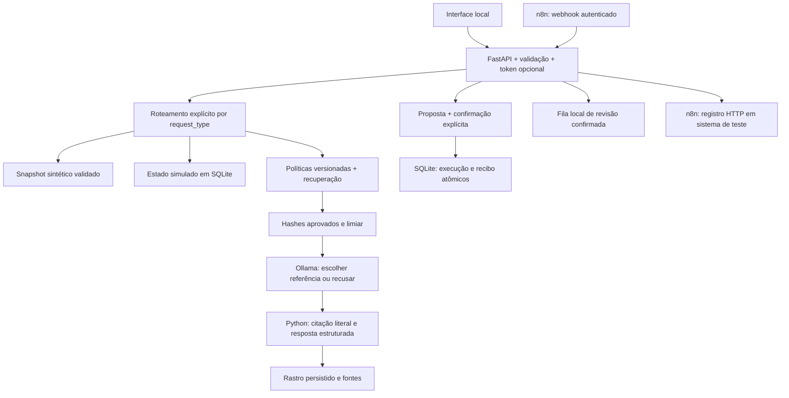

# Arquitetura da versão 1.0

## Componentes

- `core.py`, `retrieval.py`: ingestão de Markdown, chunks de até 900 caracteres, lexical, embeddings, cosseno e RRF; cache por conteúdo, digest e endpoint.
- `grounding.py`: aprovação do corpus, limiar calibrado, seleção curta e renderização literal. `llm.py` mantém geração livre experimental separada.
- `service.py`: fluxo limitado por tipo de solicitação e fonte do pedido; nenhuma ferramenta de alteração é escolhida pelo modelo. A política é uma orientação geral, não uma decisão de elegibilidade.
- `orders.py`: snapshot imutável de demonstração, com hash, data e contratos estritos.
- `actions.py`: estado simulado, propostas e execuções. SQLite `BEGIN IMMEDIATE`, versão do pedido, expiração, consumo único e replay por chave. Esquema local v1 com migração aditiva da versão anterior (0).
- `records.py`: respostas/fontes/rastros persistidos, encaminhamentos confirmados e recibos de integração. Repetições simultâneas podem repetir inferência somente leitura, mas persistem um único recibo por evento.
- `security.py`: token compartilhado opcional no ambiente local, obrigatório no modo production; bloqueio de origens diferentes em alterações e cabeçalhos básicos.
- `ui.html`, `ui.css`, `ui.js`: interface sem framework ou dependências externas, com evidências e confirmação. Dados entram no DOM por `textContent`.
- `integrations/sink.py`: processo HTTP de teste separado, com seu próprio SQLite e deduplicação. O workflow n8n chama somente atendimento e registro, nunca confirmação de cancelamento.

## Decisões

SQLite atende à demonstração local sem serviço adicional. PostgreSQL/pgvector e múltiplos agentes não foram adotados: o corpus tem seis documentos e não há evidência de ganho que justifique essa infraestrutura. A busca semântica real continua funcionando; não existe banco vetorial persistente. [Decisão de fechamento](decisions/0005-release-scope.md).

Respostas históricas guardam o estado observado, fontes e duração daquela execução. Não são atualizadas retroativamente ao cancelar um pedido. A interface usa simulation; o contrato legado padrão permanece snapshot. Dados de pedido não são enviados ao seletor de políticas.

`needs_review=true` sinaliza revisão exigida. Só `POST /handoffs`, com confirmação, cria um registro na fila. Nenhuma pessoa é notificada. Encaminhamento e cancelamento têm chaves de idempotência separadas.
