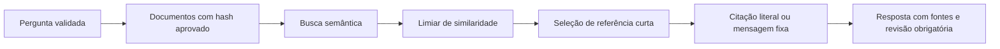

# Arquitetura atual

`POST /tickets` valida a pergunta e chama o mesmo núcleo utilizado na avaliação. O modo padrão demo usa busca lexical; ollama permite geração livre de pesquisa; grounded exige busca semântica e seleção restrita.

## Fluxo grounded

Falta de fontes, exclusão por limiar e falhas de provedor/configuração devolvem recusa com estado explícito. O modelo escolhe entre referências temporárias como quote_1, clarify e abstain. Python converte a referência no ID original e renderiza o texto completo aprovado. O modelo não pode fornecer o texto exibido neste modo.

## Componentes

- `core.py`: ingestão, baseline lexical, orquestração e rastreamento.
- `retrieval.py`: busca semântica e híbrida RRF, validação e cache em memória de vetores de documentos.
- `llm.py`: geração livre com `answer-v1.txt`; falhas semânticas conhecidas permanecem documentadas.
- `grounding.py`: manifesto, limiar, seletor com `select-v3.txt`, mapeamento de referências e renderização literal.
- `data/grounding-v3.json`: versões aprovadas das políticas e modelo de embeddings calibrado.
- `evaluation/run.py`: execução e métricas; `calibrate.py`: seleção do limiar somente no desenvolvimento; `verify_runtime.py`: checks reais por HTTP e integridade de corpus.

Fragmentos de até 900 caracteres referenciam arquivo, SHA-256 e posição. A recuperação é recalculada em memória; o cache de documentos usa conteúdo, digest e endpoint. Não há PostgreSQL/pgvector nesta etapa. Rastros de API são devolvidos na resposta, sem persistência; os experimentos arquivam rastros em JSON.

Não há ferramentas de alteração nem consulta de pedidos. Revisão obrigatória é um campo de saída, não encaminhamento executado. Citação literal não prova que a política escolhida responda à pergunta.
